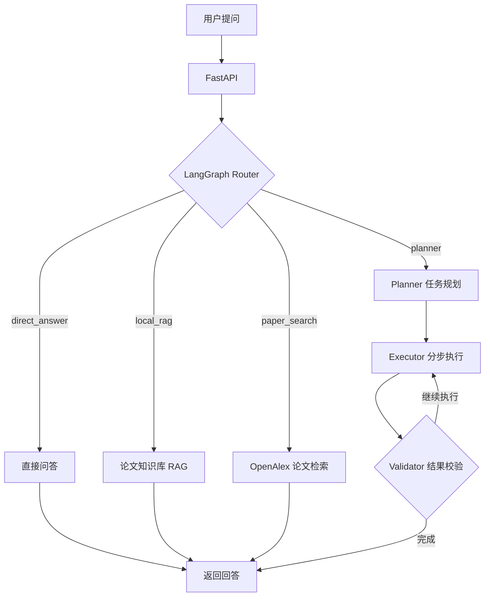
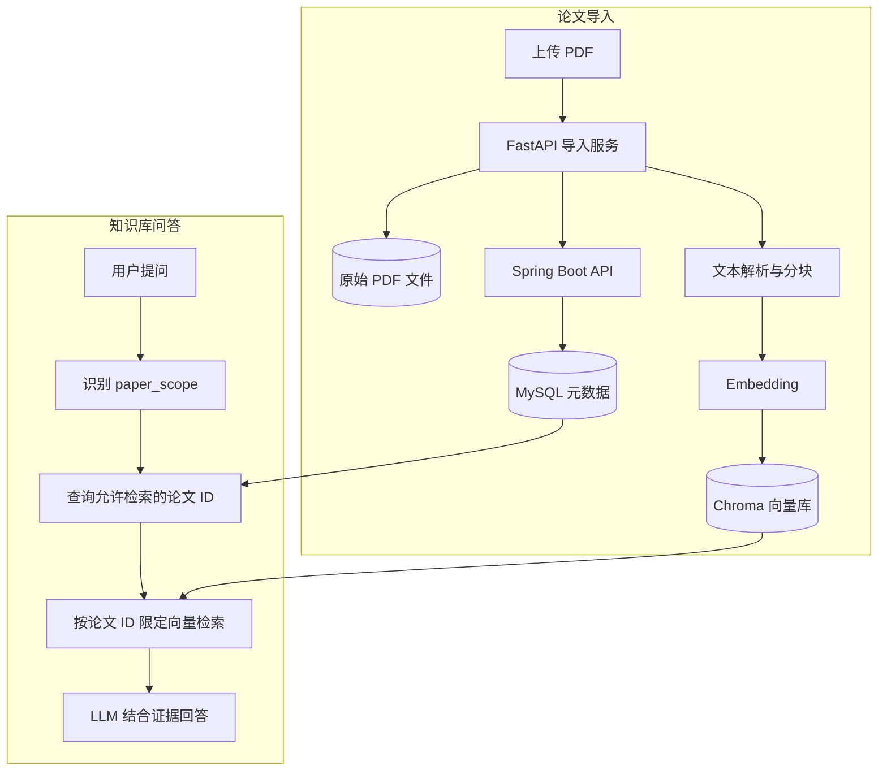
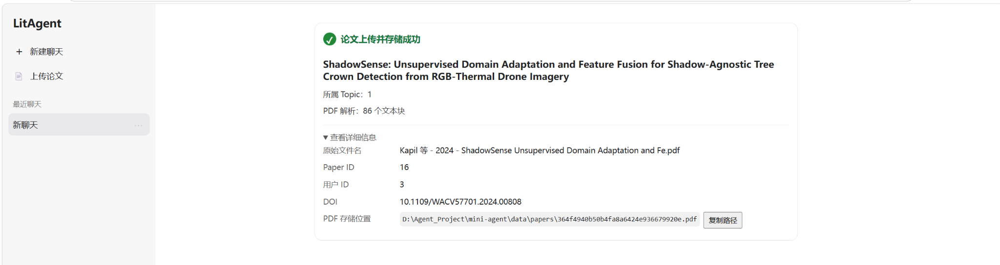
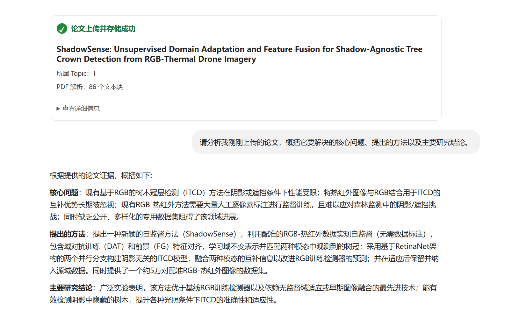
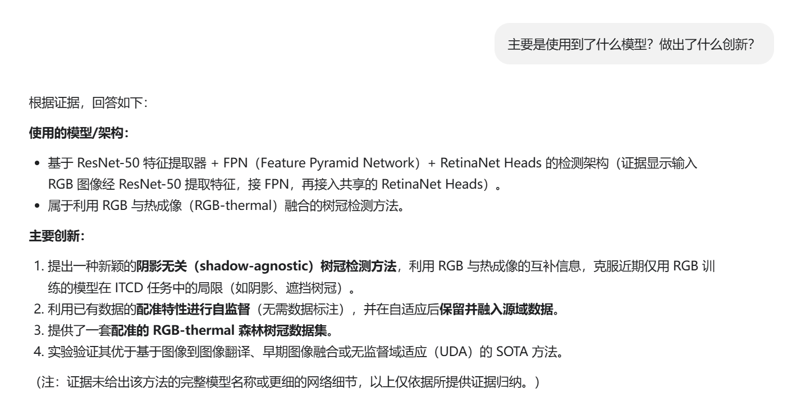
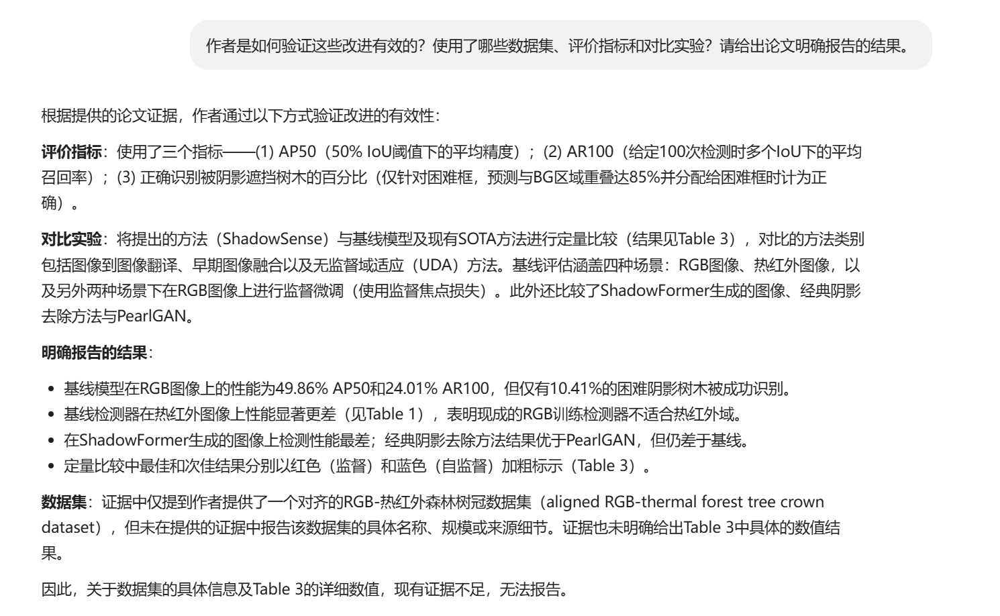
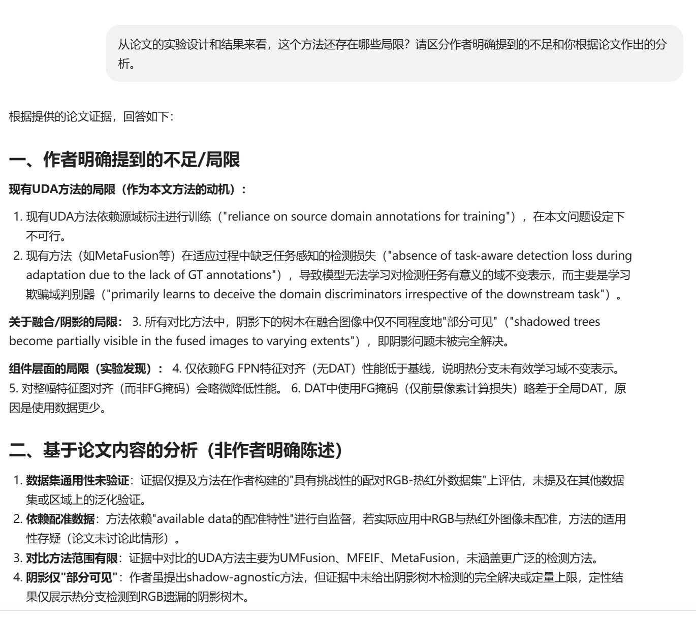
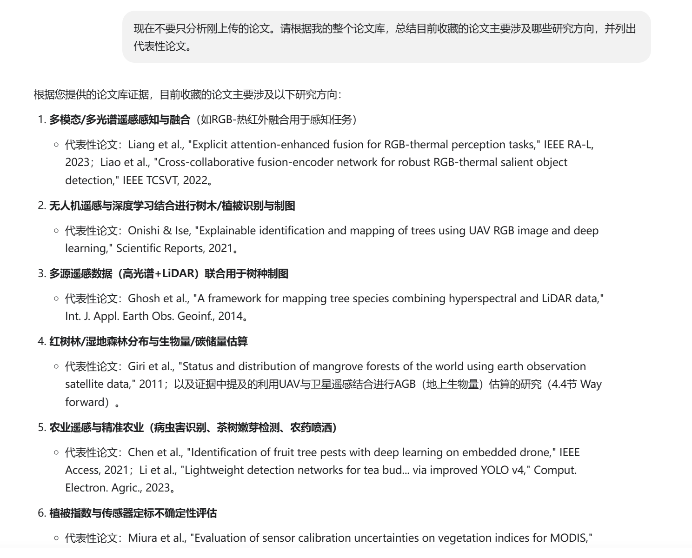
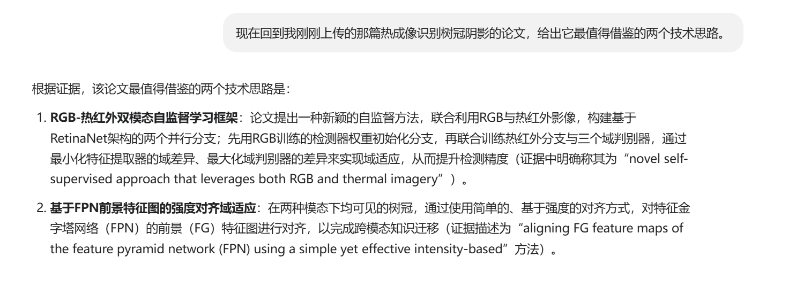

# LitAgent｜面向科研论文的智能分析 Agent

> 基于 **LangGraph + RAG** 的科研论文辅助分析系统，支持在线论文检索、PDF 导入、个人知识库问答和结合上下文的连续追问。

LitAgent 尝试解决一个实际问题：科研人员既需要搜索外部论文，也需要围绕已经收藏或上传的论文持续提问；如果检索范围没有约束，系统很容易把不同论文的内容混在一起。项目通过 **Agent 任务路由、结构化论文管理、限定范围的向量检索**，将论文搜索、导入和问答整合为一套工作流。

> **项目状态：持续开发中。** 当前以文本 PDF 解析和 RAG 为主；图片、表格、公式的多模态理解仍在规划与验证阶段。

## ✨ 核心功能

| 功能           | 说明                                                                                       |
| -------------- | ------------------------------------------------------------------------------------------ |
| Agent 任务路由 | 基于 LangGraph 和 LLM Router，区分普通问答、本地 RAG、在线论文检索与复杂任务规划。         |
| 在线论文检索   | 对接 OpenAlex，获取论文标题、作者、DOI 等元数据及可用的访问链接。                          |
| PDF 导入       | 上传并保存原始 PDF，解析文本、分块、生成向量并写入 Chroma。                                |
| 论文知识库     | 使用 Spring Boot + MySQL 管理论文、用户、研究主题及其关联关系，并按 DOI 复用已有论文记录。 |
| 上下文感知 RAG | 结合聊天历史判断问答范围，支持最近上传论文、指定 Topic 和用户论文库的范围切换。            |
| 状态持久化     | 使用 LangGraph Checkpointer 和 `thread_id` 管理会话及工作流状态。                        |

## 🧭 Agent 工作流



> 上图是便于理解的逻辑示意。具体的节点连接、异常处理及循环终止条件以 `agent/graph.py` 的实际实现为准。

### Router 的两维决策

Router 不仅判断**做什么任务**（`route`），还判断**查询哪些论文**（`paper_scope`）：

| 字段            | 可选值                                                             | 作用                         |
| --------------- | ------------------------------------------------------------------ | ---------------------------- |
| `route`       | `direct_answer` / `local_rag` / `paper_search` / `planner` | 选择处理任务的工作流。       |
| `paper_scope` | `current_paper` / `topic` / `user_library` / `none`        | 约束本地论文问答的检索范围。 |

其中，当前版本的 `current_paper` 对应**当前会话最近上传的论文**，并不等同于任意历史对话中提到的论文。

## 📚 PDF 导入与 RAG



### 为什么同时使用 MySQL 和 Chroma？

- **MySQL**：保存论文元数据、PDF 路径以及用户与 Topic 的论文关联关系，回答“谁有哪些论文”。
- **Chroma**：保存论文分块及向量，通过 `knowledge_paper_id` 过滤检索范围，回答“这些论文中有哪些相关内容”。
- **文件系统**：保存上传的原始 PDF，当前默认位于 `data/papers/`；数据库中保留路径，而不是直接保存 PDF 二进制内容。

**示例：** 用户上传一篇论文后询问“它用了什么方法？”，系统结合聊天上下文选择 `local_rag + current_paper`，使用该论文 ID 过滤 Chroma 结果，而不是检索整个人的论文库。后续询问“我的论文库有哪些研究方向？”时，则可切换到 `user_library` 范围。

## 🔍 核心技术设计

- **任务路由与检索范围分离**：`route` 决定执行直接问答、在线搜索、本地 RAG 还是多步骤规划；`paper_scope` 决定 RAG 应检索最近上传论文、指定 Topic 还是用户论文库。
- **结构化范围控制**：LLM 负责解释意图，论文 ID 列表由后端关联关系确定，Chroma 基于 `knowledge_paper_id` 执行过滤，避免仅凭模型生成的论文标识检索。
- **元数据与内容分层存储**：MySQL 管理论文及用户/Topic 关联，Chroma 检索文本分块，文件系统保存原始 PDF。上传与问答复用同一论文 ID 进行关联。

## 🛠 技术栈

| 层次         | 技术                                         |
| ------------ | -------------------------------------------- |
| Agent / 编排 | Python、LangGraph、LangChain                 |
| API / 前端   | FastAPI、HTML / JavaScript                   |
| 论文管理后端 | Java、Spring Boot、Spring Data JPA           |
| 数据存储     | MySQL、Chroma、SQLite Checkpointer、文件系统 |
| 检索与模型   | OpenAlex、Embedding、RAG、LLM API            |

## 📁 主要代码位置

```text
mini-agent/
├── agent/                          # LangGraph、Router、规划与执行逻辑
├── api/                            # FastAPI 接口
├── rag/                            # RAG 检索与问答流程
├── services/                       # 论文导入、知识库等业务服务
├── tools/                          # PDF 解析、论文检索、后端 API 客户端
├── static/index.html               # Web 界面
├── backend/knowledge-backend/      # Spring Boot + JPA 后端
└── data/papers/                    # 本地上传的 PDF（不提交到 Git）
```

## 🚀 本地运行

> 以下命令适用于 **Windows + Git Bash**，假定项目的 Python 依赖已安装到 `.venv`，MySQL 已运行且数据库配置已完成。具体依赖安装方法请依据仓库中的依赖文件确认。

**1. 配置论文管理后端**

在 `backend/knowledge-backend/src/main/resources/` 中参考 `application.properties.example` 创建本地 `application.properties`，填写 MySQL 连接信息。请勿提交密码或 API Key。

**2. 启动 Spring Boot（默认 8080）**

```bash
cd backend/knowledge-backend
mvn spring-boot:run
```

**3. 在另一个终端启动 FastAPI（默认 8000）**

```bash
# 回到 mini-agent 项目根目录
./.venv/Scripts/python.exe -m uvicorn api.main:app --reload --port 8000
```

**4. 打开页面**

- Web 界面：[http://localhost:8000/](http://localhost:8000/)
- FastAPI 文档：[http://localhost:8000/docs](http://localhost:8000/docs)

首次使用前，还需要按项目实际配置准备 LLM / Embedding 服务的凭证，以及对应的依赖和模型服务。

## 🖥 功能演示

以下展示同一会话中的真实交互流程，以 **ShadowSense: Unsupervised Domain Adaptation and Feature Fusion for Shadow-Agnostic Tree Crown Detection from RGB-Thermal Drone Imagery** 为例。

### 场景一：论文上传与知识库入库

上传论文后，系统保存原始 PDF，并将解析出的文本分块写入向量知识库；论文元数据及所属 Topic 由后端管理。

本次演示中的上传结果：**Paper ID 16、Topic 1、86 个文本块**。



### 场景二：围绕单篇论文连续追问

同一聊天窗口中，用户不必每轮重复论文标题，可以连续追问研究背景、方法创新、实验设计和研究局限。

**第一轮：概括研究问题、方法与结论。**

> 请分析我刚刚上传的论文，概括它要解决的核心问题、提出的方法以及主要研究结论。



**第二轮：进一步追问模型与创新点。**

> 主要是使用到了什么模型？做出了什么创新？



<details>
<summary><strong>展开查看更多连续追问：实验验证与研究局限</strong></summary>

**第三轮：实验验证。**

> 作者是如何验证这些改进有效的？使用了哪些数据集、评价指标和对比实验？请给出论文明确报告的结果。



**第四轮：研究局限。**

> 从论文的实验设计和结果来看，这个方法还存在哪些局限？请区分作者明确提到的不足和你根据论文作出的分析。



</details>

**技术要点：** Router 结合聊天历史判断问答意图；当 `paper_scope = current_paper` 时，RAG 以当前会话最近上传的 `paper_id` 限定检索范围。连续追问的回答仍需以论文证据为依据。

### 场景三：个人论文库检索与范围切换

**第五轮：从单篇论文切换到整个个人论文库。**

> 现在不要只分析刚上传的论文，请根据我的整个论文库，总结目前收藏的论文主要涉及哪些研究方向，并列出代表性论文。



**第六轮：重新回到最近上传的论文。**

> 现在回到我刚刚上传的那篇热成像识别树冠阴影的论文，给出它最值得借鉴的两个技术思路。



**技术要点：** 通过 `paper_scope` 在 `user_library` 与 `current_paper` 之间切换；后端根据论文关联关系取得目标论文 ID，并由 Chroma 的 `knowledge_paper_id` 元数据过滤限制检索范围。

> **演示说明：** 以上图片展示了实际交互与模型生成的回答，不代表所有科研结论、文献元数据均已独立核实。检索范围是否准确需要结合后端日志或自动化测试验证；目前尚未实现原论文页码级、Figure 级证据引用。

## 🧪 测试与当前边界

当前已在开发环境中通过既有单元测试，并通过真实论文上传与连续追问验证了指定论文 ID 的检索过滤逻辑。但仍需注意：

- 检索范围限制依赖应用传入的用户信息及论文关联检查；**当前尚不能视为完整的生产级身份认证与租户隔离方案**。
- 当前主要基于 PDF 文本解析；图表、公式及扫描页面中的关键信息可能被遗漏。
- “最近上传的论文”与“用户正在讨论的任意历史论文”尚未完全等价。
- LLM 回答仍可能不完整或出现错误，重要科研结论应核对原始论文。

## 🗺 后续计划

- [ ] PDF 按页解析，保留页码与正文证据位置。
- [ ] 提取 Figure 与图注，支持查看独立图片及原始 PDF 对应页面。
- [ ] 引入视觉语言模型进行图文联合理解。
- [ ] 评估 CLIP / SigLIP 图文检索在科研 Figure 定位中的效果。
- [ ] 完善表格、公式解析、证据引用与检索效果测试。
- [ ] 完善文件访问权限、部署流程和端到端自动化测试。

---

**说明：** LitAgent 为持续迭代的个人开发项目，主要用于探索科研场景下的 Agent 工作流、论文知识库与 RAG 技术。项目输出仅用于辅助研究，不替代对原始论文的阅读和核查。
