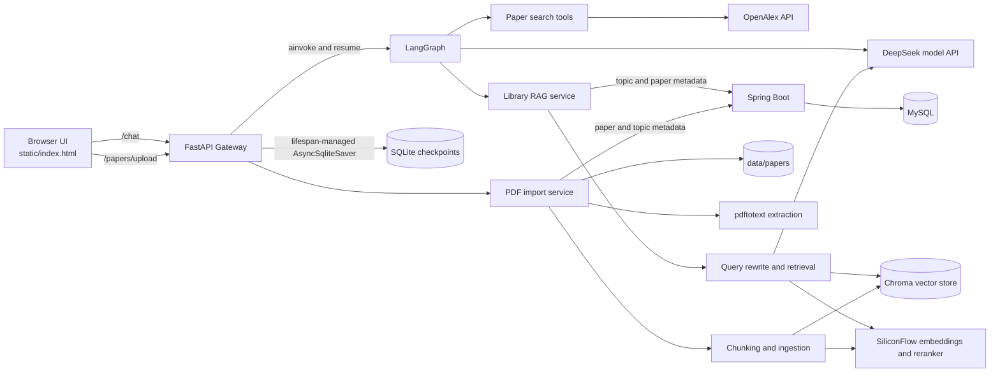
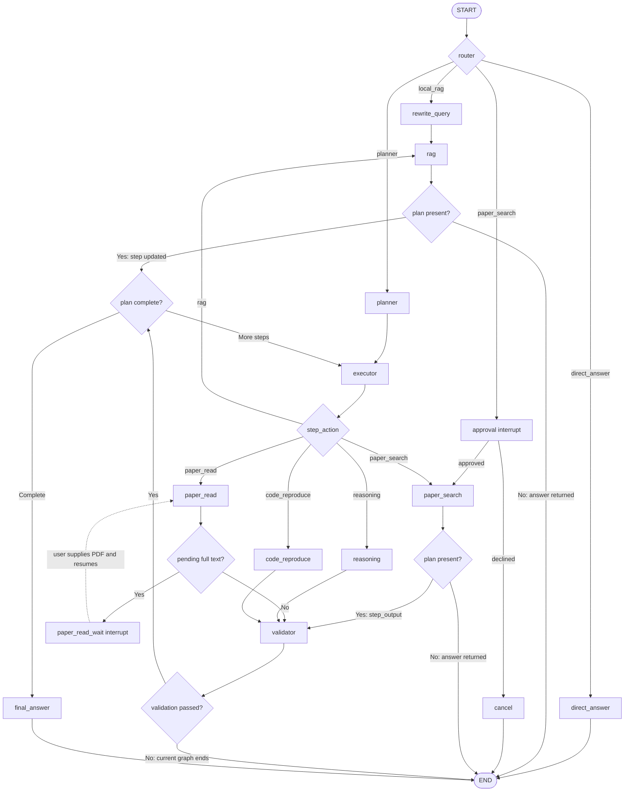
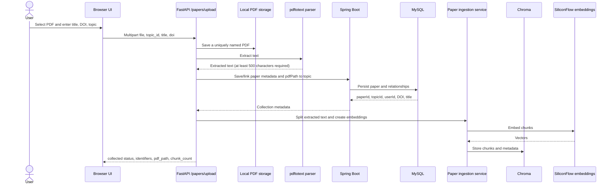
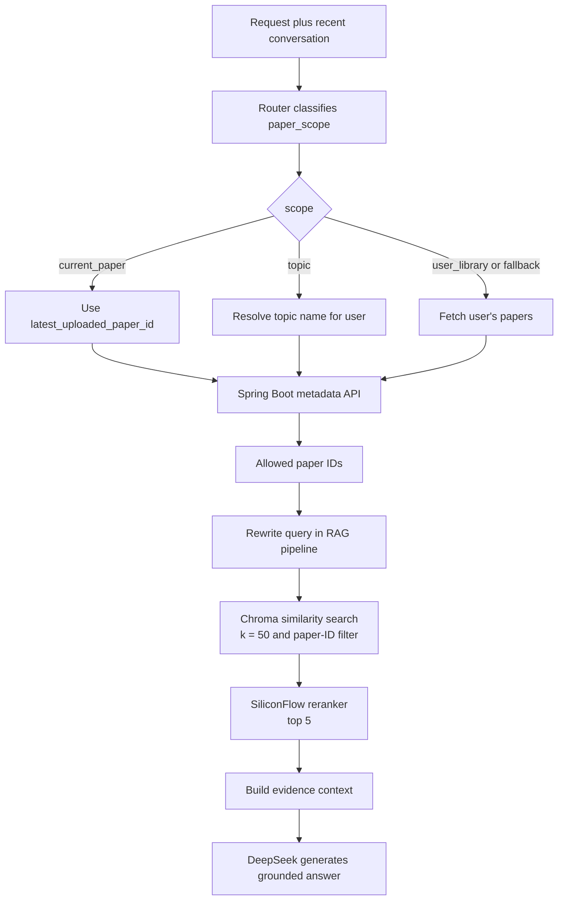

# LitAgent

LitAgent is a paper-search and research-assistance application. The Python service uses LangGraph to route requests, coordinate multi-step work, search OpenAlex, and answer questions over a user-, topic-, or paper-scoped local library. A Spring Boot service stores paper and topic metadata in MySQL; extracted text chunks and embeddings are stored locally in Chroma.

This README documents behavior currently present in the repository. Planned capabilities are not described as implemented.

## Implemented capabilities

- Route requests to direct answers, paper search, local-library RAG, or a multi-step plan.
- Search OpenAlex using structured English keywords, requested result count, and optional year bounds.
- Read abstracts and locally available PDF text; pause with a LangGraph interrupt when full text is missing.
- Validate selected planned-step results with deterministic checks.
- Upload PDFs, extract text, store paper metadata and topic association, and index text chunks in Chroma.
- Scope RAG retrieval to the current uploaded paper, a matching topic, or a user's library.
- Persist LangGraph state and interrupt checkpoints in SQLite by `thread_id`.
- Run a bounded Python repository smoke test in Docker when a GitHub repository is explicitly supplied.

## System architecture



### LangGraph request flow



### Router, Planner, Executor, and Validator

| Component | Current responsibility |
| --- | --- |
| Router | Uses the current request and recent conversation messages to choose `direct_answer`, `local_rag`, `paper_search`, or `planner`; it also classifies the requested paper scope. |
| Planner | For a complex request, asks the model for a numbered plan. It does not generate the OpenAlex query. |
| Executor | Chooses one capability for the current plan step: `paper_search`, `paper_read`, `rag`, `reasoning`, or `code_reproduce`. |
| Validator | Applies deterministic checks to planned paper-search, paper-read, reasoning, and code-reproduction outputs. It does not perform LLM-based semantic relevance validation. |

The search validator checks required paper fields and identifiers, duplicates, requested paper count, and explicit year bounds. The paper-read validator checks that content and structured analysis are present; reasoning checks for a non-empty result; code reproduction checks its reported status and exit code. When a validated step passes, the graph appends its result and advances `current_step`.

Current routing limitations are important: a failed graph-level validation ends the run; it does not automatically retry or replan. A planned `rag` step advances through `rag_node` directly and does not pass through the graph-level Validator. For a simple Router-selected paper search, the search node calls the deterministic search validator, but the result is not used as a graph-level gate. A direct paper-search request is paused for user approval; a paper search selected by the Planner does not pass through that approval node.

## Data and service responsibilities

| Component | Responsibility |
| --- | --- |
| FastAPI | Serves `static/index.html`, exposes `/chat` and `/papers/upload`, returns interrupt payloads, and owns the graph/checkpointer lifecycle. |
| LangGraph | Holds per-run state and orchestrates Router, Planner, Executor, capability nodes, interrupts, conditional edges, and final answers. |
| Spring Boot | Provides paper, topic, and user-library HTTP operations. The Python client currently targets `http://localhost:8080`. |
| MySQL | Stores paper metadata and user/topic/paper relationships through the Spring Boot service. |
| Chroma | Stores extracted paper text chunks and embeddings for similarity retrieval. The collection is `forest_papers` under `data/chroma_db`. |
| SQLite Checkpointer | Stores LangGraph checkpoints for `thread_id` so graph state and interrupts can be resumed. FastAPI creates the async connection at startup and closes it at shutdown. It is not the paper metadata database. |
| `data/papers/` | Stores uploaded source PDF files on the Python service's local filesystem. |

The browser separately stores its conversation list and messages in `localStorage`; LangGraph's SQLite checkpoint is not the browser conversation store.

## PDF upload and indexing flow



The current upload endpoint checks the `.pdf` extension, PDF signature, and a 20 MiB upload limit. Text extraction uses the external `pdftotext` executable. The splitter recognizes Markdown headings and then uses recursive chunks of 1,000 characters with 150-character overlap. The successful response includes metadata returned by Spring Boot and the ingestion `chunk_count`.

The current parser extracts text only. Understanding PDF figures/images, mathematical formulas, and table structure is **Future Work**; the current upload path does not implement multimodal PDF parsing.

## Context-aware local RAG



For `current_paper`, the frontend forwards the latest uploaded `paperId` with the chat request; the library service verifies that the paper belongs to the user's library before retrieval. For `topic`, the service resolves a topic from the user's topics and fetches papers in that topic. `user_library` (and the current code's fallback scope) retrieves the user's papers. The resulting paper IDs restrict Chroma retrieval.

The graph includes a `rewrite_query` node on the `local_rag` route. In the current implementation, scoped library-RAG calls do not forward that state's `search_query` into `answer_with_rag`; the RAG pipeline performs its own rewrite, and that rewritten query is used for Chroma search and reranking. Conversation context is used by the Router to classify scope; this is not a long-term memory system.

## Paper search, reading, and interrupts

`paper_search_request_service` converts the user's natural-language request into structured English keywords plus `top_k` and optional year bounds. `tools.paper_search` calls OpenAlex. When the Router selects the direct `paper_search` route, the graph pauses at `approval` and resumes or cancels based on the user's response.

For planned `paper_read` steps, the service reuses cached content and analyses, reads metadata from OpenAlex, and attempts to resolve an available local PDF. If the required full text is unavailable, the graph emits a `fulltext_required` interrupt with missing-paper details and a target path; after a user supplies a PDF and resumes, the read step runs again. The current graph does not automatically fetch full text through Academic MCP or download a PDF.

## Quick start

### Requirements

- Python 3.14 or later and `uv`.
- Java 17 and MySQL for library metadata, PDF collection, and scoped library RAG.
- `pdftotext` available on `PATH` for PDF text extraction.
- Docker Desktop/Engine for the bounded repository smoke-test capability.

### Python environment and model keys

From the repository root:

```bash
uv sync
```

Create a root `.env` file with the keys required by the enabled features:

```dotenv
DEEPSEEK_API_KEY=replace_with_your_key
SILICONFLOW_API_KEY=replace_with_your_key
```

`DEEPSEEK_API_KEY` is used for model calls. `SILICONFLOW_API_KEY` is used by BGE-M3 embeddings and the BGE reranker. Keep real keys out of source control.

### Start the knowledge backend (for library, upload, and RAG features)

1. Ensure a MySQL database matching the local connection settings exists.
2. Copy `backend/knowledge-backend/src/main/resources/application.properties.example` to `application.properties` in that same resources directory, then set local MySQL credentials there. The local `application.properties` is ignored by Git.
3. Start Spring Boot from `backend/knowledge-backend`:

```powershell
cd backend/knowledge-backend
.\mvnw.cmd spring-boot:run
```

The Python client currently expects the backend at `http://localhost:8080`.

### Start FastAPI and the web UI

Ensure the `data/` directory exists. In PowerShell, create it if needed with:

```powershell
New-Item -ItemType Directory -Force data
```

Then from the repository root run:

```bash
uv run uvicorn api.main:app --reload
```

Open the UI at `http://127.0.0.1:8000/`; FastAPI documentation is at `http://127.0.0.1:8000/docs`. FastAPI creates the async SQLite checkpointer connection during lifespan startup and closes it during shutdown. Press `Ctrl+C` to stop it.

The standalone Graph smoke script makes a real model call and uses the SQLite checkpoint file:

```bash
uv run python test.py
```

The automated Python tests can be run with:

```bash
uv run python -m pytest -v
```

## Repository layout

```text
agent/       LangGraph State, nodes, edges, Router context, and step validation
api/         FastAPI gateway and lifecycle management
backend/     Spring Boot knowledge backend
rag/         Embeddings, Chroma retrieval, query rewrite, and reranking
services/    Paper reading, PDF import, library RAG, search request, and sandbox services
tools/       OpenAlex, PDF, and Spring Boot HTTP adapters
static/      Native HTML/CSS/JavaScript chat UI
data/        Local PDFs, Chroma persistence, workspace, and SQLite checkpoints
tests/       Integration and unit tests
```

## Future Work

- Multimodal extraction and interpretation of PDF images/figures, formulas, and tables.
- Automatic retry/replan after failed step validation.
- Automatic online full-text acquisition in the graph's paper-reading flow.
- Long-term memory beyond recent conversation context.
