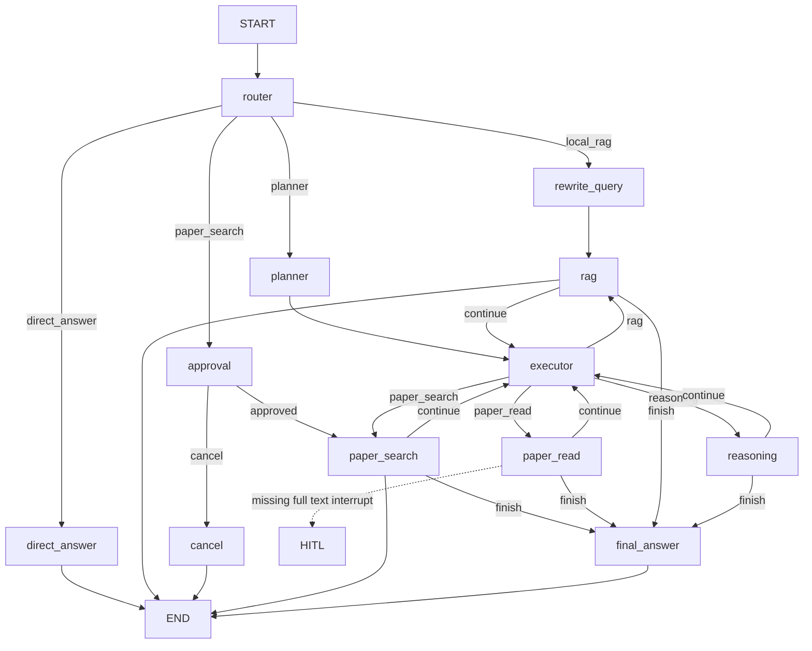

# LitAgent LangGraph Structural Refactor

## Scope

This change reorganizes the existing LangGraph workflow without adding a new
agent capability. The previous implementation is preserved as
`agent/graph_legacy.py`; `agent/graph.py` is now the maintained orchestration
entry point.

## State

`ResearchState` keeps only explicit workflow data:

- request and route: `user_query`, `route`
- search cache: `search_query`, `search_results`, `selected_papers`
- paper cache: `paper_contents`, `paper_analyses`
- planner execution: `plan`, `current_step`, `step_action`, `step_results`
- output and conversation: `answer`, `messages`, `trace`
- HITL: `approved`, `pending_fulltext`

There is no global status field and no duplicate state key. Paper contents and
analyses are keyed caches so later plan steps do not reread the same paper.

## Nodes

The maintained graph registers `router`, `planner`, `executor`,
`direct_answer`, `rewrite_query`, `rag`, `paper_search`, `paper_read`,
`reasoning`, `final_answer`, `approval`, and `cancel`.

`paper_search` is shared by direct requests and Planner steps. It calls the
existing search tool only when `search_results` is empty, then selects papers
from the cached results. `paper_read` resolves each selected paper once and
stores reusable content and structured analysis. If full text is required, it
interrupts with title, DOI, and a `data/workspace/<thread_id>/...pdf` target.

## Graph

## Compatibility

The existing `agent.graph` import remains the maintained import path, so the
FastAPI gateway and command-line scripts keep their request, response,
thread_id, streaming, and checkpoint interfaces. The SQLite checkpoint path
remains `data/checkpoints.sqlite` by default.

## Remaining TODOs

- Full-text PDF parsing and extraction are still outside this refactor.
- Uploading or copying a user-provided PDF into the workspace is still an
  external HITL responsibility.
- Paper ranking, retries, and error recovery remain existing roadmap items.
- Experimental HTML/PDF/MCP scripts remain because they still have direct
  script references or are retained by the legacy graph.
